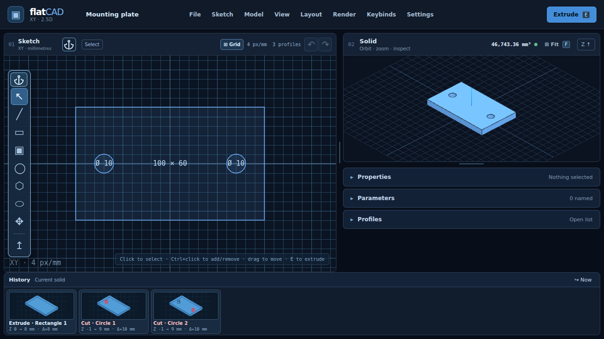
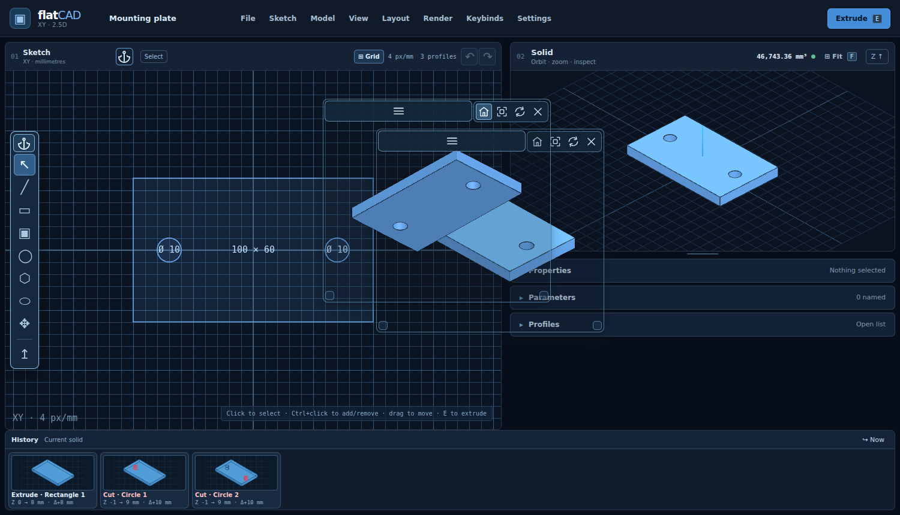

# flatCAD

**flatCAD** is a local-first, browser-based 2.5D CAD editor for plates, panels, brackets and similar prismatic parts. Draw profiles in an XY sketch measured in millimetres; add or remove material along Z. Exact OpenCascade boundary-representation (B-rep) geometry drives the solid preview and STEP export.

**Beta 1 status:** The Sketch/Solid workflow and interface passed owner interaction testing and automated browser tests. STEP export is implemented, but independent STEP readback and fabrication-grade validation remain outstanding. **Do not treat this beta as manufacturing-qualified.**



*XY sketch, exact solid preview and ordered feature history.*



*Multiple independent Solid cameras; the Sketch and model share one document.*

## Features

| Area | Available in Beta 1 | Scope / limitation |
| --- | --- | --- |
| Sketch | Rectangles, centre rectangles, circles, polygons, slots, open/closed polylines; grid and geometry snapping | Single XY plane; no constraint solver, trim/offset or general region extraction |
| Solid modelling | Exact sequential add/cut extrusions, signed Z depths, through-all assistance, temporary solid preview | Z-directed features; no arbitrary sketch workplanes, fillets or chamfers |
| Editing | Selection and groups, move/duplicate/delete, numeric properties, named parameters, undo/redo, editable feature history | Feature evaluation order remains chronological |
| Workspace | Resizable Sketch/Solid panels, dockable Sketch toolbar, history thumbnails, up to three independent floating Solid views | View settings do not change model geometry |
| Presentation | Orthographic orbit/pan/zoom, CAD outlines, MSAA and experimental rendering controls | AO and high-resolution supersampling are not quality-qualified |
| Files | Local autosave, versioned `.flatcad.json` save/open, STEP export, settings JSON import/export | No STEP import; independent STEP round-trip validation pending |

## Run locally

Requires **Node.js 22+** and a current desktop browser (Firefox or Chrome).

```sh
git clone https://github.com/techrote/flatCAD.git
cd flatCAD
npm install --no-audit --no-fund
npm run dev
```

Open the local URL printed by Vite. On Windows PowerShell, use `npm.cmd` if `npm` is blocked by execution policy. The repository does not currently include a lockfile: use `npm install`, **not** `npm ci`.

For a production bundle: `npm run build`, then `npm run preview`. The OpenCascade WASM worker runs locally; no account or hosted backend is needed.

## Documentation

- **[User guide](docs/USER-GUIDE.md)** — first model, sketching, extrusions, history, file handling and views
- **[Reference sheet](docs/REFERENCE-SHEET.md)** — tools, defaults, shortcuts, navigation and menu paths
- [Architecture](docs/ARCHITECTURE.md) · [Roadmap](docs/ROADMAP.md) · [Qualification criteria](docs/ACCEPTANCE.md)
- [Original README (archive)](docs/README-ARCHIVE-2026-11-09.md) · [Screenshot provenance](docs/images/README.md)

## Licence and qualification

The project does not yet specify its own licence; public source availability does not grant a reuse licence. Dependencies have separate obligations, including OpenCascade WASM. See [dependency and licence notes](docs/DEPENDENCIES.md). The beta is not certified for fabrication, dimensional tolerances or downstream STEP interchange.
